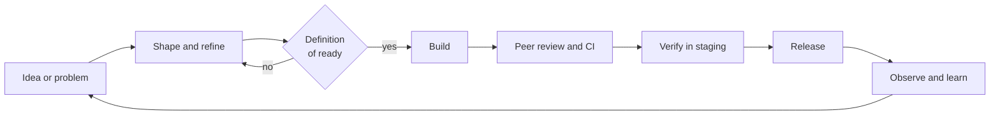

# 01. Software development lifecycle

**Purpose:** a shared, lightweight way to take work from idea to production, with enough quality gates to ship safely and few enough to ship often.

**Audience:** every engineer, product manager and QA specialist on the team.

## 1. Flow at a glance

## 2. Stages

### 2.1 Shape
- Describe the **problem**, the **user** and the **outcome**, not just the solution.
- For anything that takes more than about a week, or changes an interface other teams use, write a short [RFC](../templates/rfc.md) and get review before building.
- Split work into slices that can ship independently, ideally a few days each.

### 2.2 Definition of ready
A work item is ready to start when:
- The problem and acceptance criteria are written and agreed with product
- Dependencies and risks are identified
- Design or API changes have been reviewed where needed
- It is small enough to finish within one iteration, or split
- The team knows how success will be measured or observed

### 2.3 Build
- One branch per change, short-lived (ideally merged within 1 to 3 days)
- Prefer trunk-based development with feature flags over long-running branches
- Write tests with the change: unit tests for logic, integration tests for boundaries, end-to-end tests for critical user journeys only
- Commit messages explain why, not only what

### 2.4 Review and CI
- Every change gets at least one peer review (see [code review](02-code-review.md))
- CI must pass before merge: build, tests, linting, dependency and security scanning
- No merging with red CI. Fix flaky tests promptly; a flaky suite teaches people to ignore failures

### 2.5 Verify
- Deploy to a staging environment that mirrors production where it matters
- The author checks the acceptance criteria; product or QA verifies user-facing behaviour
- Risky changes (data migrations, auth, billing) get a second look and a written rollback plan

### 2.6 Release
- Deploy small and often. Default to automated deployment of every merged change
- Use feature flags to separate **deploy** (code in production) from **release** (users see it)
- Roll out gradually where possible: internal users, a small percentage, then everyone
- Every deployment is reversible. State how before you start

### 2.7 Observe
- After release, watch the dashboards for the affected area for a defined period
- Check the outcome you set in shaping. Did it work?
- Remove feature flags and dead code once a release is stable

## 3. Definition of done

A change is done when:
- It is deployed to production (or behind a flag in production)
- Tests and monitoring cover the new behaviour
- Documentation, runbooks and API references are updated
- Acceptance criteria are verified
- The outcome is being observed

## 4. Environments

| Environment | Purpose | Data | Who can deploy |
|---|---|---|---|
| Local | Development | Synthetic | Everyone |
| CI | Automated checks | Synthetic | Pipeline |
| Staging | Pre-release verification | Anonymised or synthetic, never raw production data | Pipeline |
| Production | Real users | Real | Pipeline, with approval for risky changes |

## 5. Quality gates

| Gate | Required for | Typical check |
|---|---|---|
| Automated tests and lint | Every change | CI pipeline |
| Peer review | Every change | At least one approving reviewer |
| Security scan | Every change | Dependency and static analysis |
| Design or RFC review | Large or cross-team changes | Written approval from affected owners |
| Migration review | Database or data changes | Reviewer with data experience, rollback plan |
| Release approval | High-risk changes only | Named approver, scheduled window |

## 6. Hotfixes

A hotfix is a small, urgent change to fix a production problem.
1. Declare it in the incident channel if an incident is open
2. Branch from production, make the smallest fix, add a test if possible
3. Review by one engineer (do not skip it; use a quick synchronous review instead)
4. Deploy through the normal pipeline
5. Follow up with a proper fix and a [postmortem](../templates/postmortem.md) if it was an incident

## 7. Technical debt

- Keep a visible debt list with a short impact statement per item
- Reserve a steady share of capacity (a common starting point is 15 to 20 percent) for debt, reliability and tooling
- Fix the debt that slows delivery or causes incidents first

## 8. Changelog

| Date | Change | Reason |
|---|---|---|
| YYYY-MM-DD | Initial version | |
