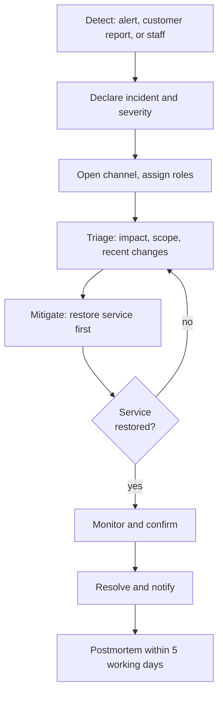

# 03. Incident response

**Purpose:** restore service quickly, communicate clearly, and learn so the same failure does not recur.

**Scope:** any unplanned event that degrades or interrupts a customer-facing service, or exposes data.

## 1. Severity levels

Adjust the examples and response targets to your service commitments.

| Level | Definition | Examples | Response target | Update cadence |
|---|---|---|---|---|
| SEV1 | Critical: major outage or data exposure affecting many customers or core functions | Platform down, login failing for most users, confirmed data breach | Acknowledge within 15 min, incident commander assigned immediately | Every 30 min |
| SEV2 | Major: significant degradation or a key function unavailable for some customers | Payments failing for a region, severe slowness, a major feature down | Acknowledge within 30 min | Every 60 min |
| SEV3 | Moderate: limited impact with a workaround | A non-critical feature broken, delayed background jobs | Within 4 working hours | Daily |
| SEV4 | Minor: cosmetic or low impact | Small UI defects | Normal backlog | As needed |

**When in doubt, declare the higher severity.** You can downgrade later; you cannot get back the time lost.

## 2. Roles

| Role | Responsibility |
|---|---|
| Incident commander (IC) | Owns the incident. Coordinates, makes decisions, assigns tasks, decides when it is resolved. Does not debug |
| Operations lead | Leads the technical investigation and the fix |
| Communications lead | Writes internal and customer updates on the agreed cadence |
| Scribe | Records the timeline, decisions and actions in the incident channel or document |
| Subject-matter experts | Pulled in by the IC as needed |

For small teams, one person may hold two roles, but the IC and the person debugging should be different people for SEV1 and SEV2.

## 3. Response flow

### 3.1 Detect and declare
- Anyone can declare an incident. No permission needed.
- Create a dedicated channel named with the date and a short title, for example `inc-2026-03-12-login-errors`.
- State the severity, the symptoms, the start time and the current IC.

### 3.2 Triage
- What is the customer impact, and who is affected?
- What changed recently (deploys, flags, configuration, dependencies, traffic)?
- Is it getting worse? Is there a quick mitigation?

### 3.3 Mitigate first, diagnose second
The goal is to stop the harm. Prefer the fastest safe action:
- Roll back the last change or disable a feature flag
- Fail over, scale up or shed load
- Block the offending traffic
- Switch to a degraded mode

Root-cause analysis happens after service is restored.

### 3.4 Communicate
- **Internal:** a status post in the incident channel at the agreed cadence, even when nothing changed ("still investigating, next update at 14:30").
- **Customers:** use the [status update template](../templates/incident-status-update.md). Be factual, say what you know and what you do not, and never speculate about cause.
- **Executives and support:** a single summary line with impact, status, next update time and owner.
- **Security or data incidents:** involve the security lead and legal at once; regulatory notification clocks (for example, 72 hours under GDPR for personal data breaches) may apply.

### 3.5 Resolve
- The IC declares resolution once metrics are back to normal for an agreed period.
- Send a final notice to customers and internal teams.
- Create follow-up tickets for fixes, with owners and dates.

## 4. Postmortem

- Required for every SEV1 and SEV2, and for any incident with a new or interesting failure mode.
- Held within five working days, using the [postmortem template](../templates/postmortem.md).
- **Blameless:** ask how the system allowed the failure, not who caused it. People acted reasonably with the information they had.
- Focus on: timeline, impact, contributing factors, what went well, what was lucky, and concrete actions.
- Actions have an owner and a due date, and are tracked to completion. Review open actions monthly.
- Share the postmortem widely. Learning is the point.

## 5. Preparedness

- Keep runbooks for the top failure scenarios, linked from alerts
- Run a game day each quarter: simulate an incident and practise the flow
- Maintain an up-to-date contact list and escalation path
- Review alert quality monthly: remove noisy alerts, add missing ones

## 6. Changelog

| Date | Change | Reason |
|---|---|---|
| YYYY-MM-DD | Initial version | |
